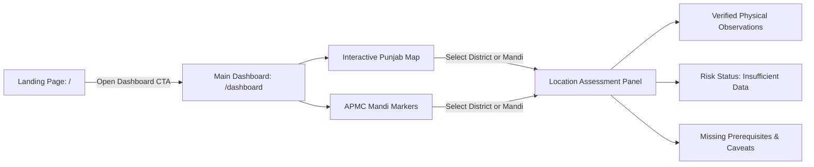

# Punjab GrainWatch

**Purpose:** An honest, reproducible, evidence-based agricultural intelligence platform for exploring **potential grain-hoarding risk locations across Punjab's 23 districts**.

> **Scope Boundary & Evidence Guardrails:**  
> Punjab GrainWatch strictly adheres to the [`AGENTS.md`](AGENTS.md) evidentiary protocol:
> - A statistical anomaly is strictly an **investigation prompt**, never proof of intent or illegal hoarding.
> - The application **never** computes actor-level hoarding scores, ranks named traders/mandis, or invents risk metrics.
> - When empirical prerequisites are missing, the system explicitly displays: **`Insufficient data to assess risk`**.

---

## 1. The Two Core Experiences

The application is strictly focused on two user-facing experiences:



### A. Landing Page (`/`)
- Clear product identity and explanation of potential grain-hoarding risk screening.
- Primary Call to Action: **Open Dashboard** (`/dashboard`).
- Polished 3D agricultural visualizer (`Hero3DScene`) with accessible static SVG fallback and motion pause control.
- 3-step explanation of how spatial ingestion, the 7-point qualification gate, and transparent assessments work.
- Explicit summary of system boundaries and governance limitations.

### B. Main Dashboard (`/dashboard`)
- **Interactive Punjab Map:** Scaled SVG choropleth rendering all 23 official district boundary polygons (EPSG:4326 from Survey of India / NWIC).
- **Location Markers:** Verified APMC mandis plotted at accurate district coordinates.
- **Selected Location Assessment Panel:**
  - Administrative details (name, LGD code, headquarters).
  - Hoarding Risk Assessment: prominently displays **"INSUFFICIENT DATA TO ASSESS RISK"** with explicit reasons.
  - Verified physical observations: historical wheat/rice production and yields (DES APY), daily wholesale prices (AGMARKNET), and agro-weather context (NASA POWER).
- **Minimal Filters:** District dropdown selector and evidence focus toggles.
- **Graceful States:** Loading skeleton, friendly empty filter state, and structured error notifications.

---

## 2. Verified Evidence Invariants

1. **Zero Foodgrain Arrivals in Acquired Panel:** The acquired 3,892-row mandi arrival panel from e-Mandikaran covers 62 produce crops (fruits, vegetables, cash crops) and contains **zero wheat or paddy grain records**. The 71 rows matching substring `dhan` were verified as Coriander Green (*Hara Dhaniya*).
2. **Paddy Prices Lack Arrival Quantities:** AGMARKNET 2.0 daily price feeds (53 rows) report wholesale modal prices only; arrival quantities are **100% unexposed (null)**. Prices cannot proxy volume.
3. **National Buffer Stocks:** DFPD central pool stock observations (100 rows, 2020–2026) represent the **India total aggregate** (state is 100% null). Facility-level warehouse stocks are unmeasured.
4. **Procurement Snapshot Semantics:** CFPP wheat procurement (3 rows) represents a **single observation date (`2025-05-15`)** across 3 distinct temporal bases. These rows cannot be summed or interpolated as a daily time series.

---

## 3. Technology Stack & Design System

- **Frontend:** [Astro](https://astro.build/) (v7.4) + [React](https://react.dev/) (v19) + [TypeScript](https://www.typescriptlang.org/) (v5.7) with custom design tokens adhering to [`DESIGN.md`](DESIGN.md) (Google Material clarity + Apple typographic restraint).
- **Backend:** [FastAPI](https://fastapi.tiangolo.com/) (v0.141) + [Uvicorn](https://www.uvicorn.org/) (v0.52) + [Pydantic](https://docs.pydantic.dev/) (v2.11) with typed configuration, safe path containment, and secret-scrubbed logging.
- **Testing:** [pytest](https://docs.pytest.org/) with 112 automated unit, API, schema, and UI tests running locally with zero external network dependencies.

---

## 4. Quick Start & Local Development

### Prerequisites
- Python 3.13+
- Node.js v20+ and npm

### Step 1: Rebuild Data Catalog & Quality Report
Run the repeatable validation pipeline:
```powershell
python scripts/run_validation_pipeline.py
```
*Verifies 49/49 manifest checksums, enforces critical domain assertions, and outputs `dataset_catalog.json` and `quality_report.json`.*

### Step 2: Run Automated Tests
Execute the comprehensive test suite (112 tests):
```powershell
pytest -v
```

### Step 3: Run Frontend Diagnostics & Build
```powershell
npm run check --prefix frontend
npm run build --prefix frontend
```

### Step 4: Start Development Servers

#### Option A: One-Command PowerShell Runner
```powershell
.\scripts\run_dev.ps1 -Mode all
```

#### Option B: Separate Terminals

**Terminal 1 — FastAPI Backend:**
```powershell
python -m uvicorn backend.main:app --host 127.0.0.1 --port 8000 --reload
```

**Terminal 2 — Astro Frontend:**
```powershell
npm run preview --prefix frontend -- --port 4321 --host 127.0.0.1
```

---

## 5. Primary Application URLs

| Interface | URL | Purpose |
| :--- | :--- | :--- |
| **Landing Page** | `http://localhost:4321/` | Executive landing page with "Open Dashboard" CTA and 3D visual |
| **Main Dashboard** | `http://localhost:4321/dashboard` | Interactive Punjab map, APMC markers, and location assessment |
| **FastAPI Swagger Docs** | `http://127.0.0.1:8000/docs` | Interactive OpenAPI documentation |
| **Backend Health** | `http://127.0.0.1:8000/api/v1/health` | Component health check |
| **Eligibility Gates API**| `http://127.0.0.1:8000/api/v1/analytics/eligibility-gate` | 7-point statistical anomaly qualification matrix |
| **District GeoJSON API** | `http://127.0.0.1:8000/api/v1/geo/districts` | Verified district boundary geometries (EPSG:4326) |
| **Market Prices API** | `http://127.0.0.1:8000/api/v1/markets/prices` | Verified AGMARKNET daily wholesale modal prices |
