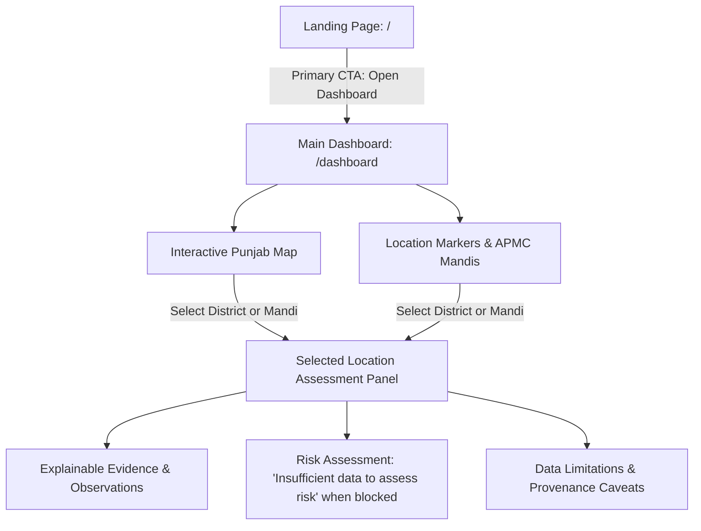

# Punjab GrainWatch Simplification Plan

**Document Version:** 1.0.0  
**Date:** 2026-10-22  
**Architect:** Senior Software Architect & Simplification Engineer  
**Status:** APPROVED FOR IMPLEMENTATION  
**Recovery Tag:** `pre-simplification-checkpoint` (Git commit `28e4844`)

---

## 1. Executive Summary & Core Mission Scope

Punjab GrainWatch is a focused intelligence dashboard designed for exploring **potential grain-hoarding risk locations across Punjab**.

Over previous phases, the application accumulated secondary standalone modules, exploratory analysis views, separate price monitors, and disparate pages that dilute its primary mission. This plan defines the surgical simplification of the platform into exactly two primary user experiences:



### Core Architecture: The Two Primary Experiences
1. **Landing Page (`/`):**
   - Clear product identity & mission: Grain-hoarding risk screening across Punjab.
   - Concise explanation of screening methodology and evidentiary limitations.
   - Single primary call to action: **Open Dashboard**.
   - Polished Punjab agricultural hero visual (with static fallback and reduced-motion controls).
   - Clean, minimal footer.
2. **Main Dashboard (`/dashboard`):**
   - Interactive SVG/GeoJSON map of Punjab (all 23 districts and verified APMC mandi points).
   - Location markers supported by verified data.
   - Selected-location details panel:
     - Identity (district name, administrative status, coordinates).
     - Available observations (crop production, yield history, modal prices, weather).
     - Explainable risk assessment: displays **"Insufficient data to assess risk"** unless empirical prerequisites pass.
     - Contributing indicators and explicit data limitations (0 wheat/paddy arrival rows, unmeasured private storage, anomaly != hoarding).
   - Minimal filters (geography dropdown, crop type where supported).
   - Graceful empty, loading, and error states.

---

## 2. Comprehensive Inventory & Feature Classification

Every route, UI component, backend endpoint, and dataset is audited and classified:
- **KEEP:** Directly supports the two core experiences.
- **SIMPLIFY:** Useful to the core experience, but needs reduction in complexity.
- **REMOVE:** Outside the product scope or redundant.
- **INVESTIGATE:** Requires verification of dependencies before action.

### 2.1 User-Facing Frontend Routes (`frontend/src/pages/`)

| Route | Current Status & Purpose | Classification | Action & Dependency Impact |
| :--- | :--- | :---: | :--- |
| `/` (`index.astro`) | Multi-card hub with 8 secondary view links | **SIMPLIFY** | Refactor into clean, focused landing page with "Open Dashboard" CTA and agricultural visual. Remove hub cards to deleted routes. |
| `/dashboard` | Does not exist | **NEW / MERGE** | Create as the single primary interactive dashboard by evolving `/district-map`. |
| `/district-map` (`district-map.astro`) | Map viewer with drawer | **REMOVE** | Functionality merged and upgraded into `/dashboard.astro`. Route deleted. |
| `/analytics` (`analytics.astro`) | Standalone gate matrix & synthetic lab | **REMOVE** | Gate status & evidence limitations integrated directly into Dashboard assessment panel. Delete route. |
| `/datasets` (`datasets.astro`) | Standalone dataset catalog & JSON downloader | **REMOVE** | Standalone catalog explorer is out of scope. Delete route. |
| `/market-watch` (`market-watch.astro`) | Standalone mandi price chart & table | **REMOVE** | Price observations available directly in Dashboard location panel. Delete route. |
| `/weather` (`weather.astro`) | Standalone NASA POWER station viewer | **REMOVE** | Agroclimatological context integrated into location panel. Delete route. |
| `/procurement-stocks` (`procurement-stocks.astro`) | Standalone procurement & national stocks | **REMOVE** | Standalone macro views outside location screening scope. Delete route. |
| `/production-yield` (`production-yield.astro`) | Standalone district production & yield | **REMOVE** | District production & yield history integrated into Dashboard location panel. Delete route. |
| `/status` (`status.astro`) | Standalone pipeline health & audit matrix | **REMOVE** | Secondary technical dashboard outside user-facing scope. Delete route. |
| `/methodology` (`methodology.astro`) | Standalone 8-rule methodology document | **REMOVE** | Core limitations embedded on landing page and in location assessment panel. Delete route. |

**Result:** Routes reduced from 10 to **2** (`/` and `/dashboard`).

---

### 2.2 Frontend Components (`frontend/src/components/`)

| Component | File | Classification | Rationale & Action |
| :--- | :--- | :---: | :--- |
| `DistrictMapView.tsx` | `frontend/src/components/DistrictMapView.tsx` | **SIMPLIFY** | Evolve into `DashboardView.tsx`. Upgrade with location markers, assessment panel, risk status, and filters. |
| `Hero3DScene.tsx` | `frontend/src/components/Hero3DScene.tsx` | **KEEP** | Polished agricultural silo & field visual for the landing page with pause toggle and static SVG fallback. |
| `AppShell.astro` | `frontend/src/layouts/AppShell.astro` | **SIMPLIFY** | Strip 10-item top navigation down to 2 links: **Home** and **Dashboard**. |
| `StatusBadge.tsx` | `frontend/src/components/StatusBadge.tsx` | **KEEP** | Reusable evidence status pill used in location details panel. |
| `GuardrailBanner.astro` | `frontend/src/components/GuardrailBanner.astro` | **KEEP / SIMPLIFY** | Reusable limitation banner for landing page and dashboard. |
| `MetricCard.astro` | `frontend/src/components/MetricCard.astro` | **SIMPLIFY** | Keep for clean metric summary on landing page if needed. |
| `AnalyticsGateView.tsx` | `frontend/src/components/AnalyticsGateView.tsx` | **REMOVE** | Exclusive to removed `/analytics` route. Core gate logic remains in backend service. |
| `DatasetExplorer.tsx` | `frontend/src/components/DatasetExplorer.tsx` | **REMOVE** | Exclusive to removed `/datasets` route. |
| `MarketWatchView.tsx` | `frontend/src/components/MarketWatchView.tsx` | **REMOVE** | Exclusive to removed `/market-watch` route. |
| `ProcurementStocksView.tsx` | `frontend/src/components/ProcurementStocksView.tsx` | **REMOVE** | Exclusive to removed `/procurement-stocks` route. |
| `ProductionYieldView.tsx` | `frontend/src/components/ProductionYieldView.tsx` | **REMOVE** | Exclusive to removed `/production-yield` route. |
| `QualityReadinessView.tsx` | `frontend/src/components/QualityReadinessView.tsx` | **REMOVE** | Exclusive to removed `/status` route. |
| `SystemHealthMonitor.tsx` | `frontend/src/components/SystemHealthMonitor.tsx` | **REMOVE** | Exclusive to removed `/status` route. |
| `WeatherView.tsx` | `frontend/src/components/WeatherView.tsx` | **REMOVE** | Exclusive to removed `/weather` route. |

**Result:** UI components reduced from 13 to **5** (`DashboardView.tsx`, `Hero3DScene.tsx`, `AppShell.astro`, `StatusBadge.tsx`, `GuardrailBanner.astro`).

---

### 2.3 Backend API Endpoints & Services (`backend/`)

Per the core requirement:  
> *"Do not remove legitimate backend functionality, source data, acquisition scripts, API integrations, or research evidence simply because they are not visible in the UI."*

| Backend Component | Classification | Action | Rationale |
| :--- | :---: | :---: | :--- |
| `backend/main.py` | **KEEP** | Retain | Provides FastAPI routing, CORS, and health verification. |
| `backend/api/routes/geography.py` | **KEEP** | Retain | Powers district GeoJSON and LGD crosswalk for the Dashboard map. |
| `backend/api/routes/production.py` | **KEEP** | Retain | Serves district production records for the selected location panel. |
| `backend/api/routes/yields.py` | **KEEP** | Retain | Serves district yield history for the selected location panel. |
| `backend/api/routes/prices.py` | **KEEP** | Retain | Serves APMC mandi prices for location marker inspection. |
| `backend/api/routes/weather.py` | **KEEP** | Retain | Serves district agro-weather data. |
| `backend/api/routes/analytics.py` | **KEEP** | Retain | Powers 7-point eligibility gate and readiness metrics. |
| `backend/api/routes/health.py` | **KEEP** | Retain | System health and status telemetry. |
| `backend/api/routes/datasets.py` | **KEEP** | Retain | Catalog metadata endpoints. |
| `backend/api/routes/quality.py` | **KEEP** | Retain | Quality metrics and issues endpoints. |
| `backend/services/*` | **KEEP** | Retain | Core business logic and data ingestion engines. |
| `backend/schemas/*` | **KEEP** | Retain | Typed domain contracts for API payloads. |

---

### 2.4 Data & Validation Scripts (`data/` & `scripts/`)

| Directory | Classification | Action | Rationale |
| :--- | :---: | :---: | :--- |
| `data/inbox/` | **KEEP (IMMUTABLE)** | Retain untouched | Original source drops from Gemini Phase 5. |
| `data/manifests/` | **KEEP** | Retain | Canonical manifests, checksums, and dataset catalog. |
| `data/derived/` | **KEEP** | Retain | Quality reports and import audit manifests. |
| `data/synthetic/` | **KEEP (ISOLATED)** | Retain | Synthetic what-if scenario (excluded from default views). |
| `frontend/public/data/*.json` | **KEEP** | Retain | Validated offline static fallback data caches. |
| `scripts/run_validation_pipeline.py`| **KEEP** | Retain | Master validation and hash-checking pipeline. |
| `scripts/data_validation/*` | **KEEP** | Retain | Modular validation engine. |

---

## 3. Detailed Architecture of the Simplified Product

### 3.1 The Landing Page (`/` -> `frontend/src/pages/index.astro`)
1. **Header & Navigation:** Minimal `AppShell` with links to **Home** and **Dashboard**.
2. **Hero Section:**
   - Headline: *Punjab GrainWatch — Agricultural Evidence & Supply-Flow Intelligence*.
   - Subtitle: *Empirical screening of foodgrain supply chains and potential hoarding risk indicators across Punjab's 23 districts.*
   - Primary Call-to-Action button: `Open Dashboard` (`href="/dashboard"`), with clear visual prominence.
   - Interactive 3D Silo & Field Visualizer (`Hero3DScene`) with accessible static SVG blueprint fallback.
3. **How It Works (3-Step Explainer):**
   - Step 1: *Spatial Ingestion* (Maps 23 Punjab districts and active APMC mandi locations).
   - Step 2: *7-Point Qualification Gate* (Verifies commodity type, volume presence, and baseline depth before calculation).
   - Step 3: *Explainable Assessment* (Displays location evidence or explicitly reports insufficient data).
4. **Core Evidentiary Boundaries & Limitations:**
   - 0 wheat/paddy arrival rows in acquired APMC panel (produce only).
   - 100% null arrival volumes in Agmarknet price feed.
   - National DFPD buffer stocks cannot be downscaled to Punjab silos.
   - Statistical anomaly != illegal hoarding.
5. **Clean Footer:** Version, data provenance notes, and link to GitHub/docs.

---

### 3.2 The Main Dashboard (`/dashboard` -> `frontend/src/pages/dashboard.astro`)
1. **Header Bar:**
   - Breadcrumb/Title: *Punjab GrainWatch Dashboard*.
   - Minimal Filter Bar:
     - District Selector (All 23 districts or select specific district).
     - Data Type Focus (All, Production/Yield, Mandi Prices, Weather).
2. **Main Layout (Split View):**
   - **Left / Center (Primary): Interactive Punjab Map**
     - Scaled SVG choropleth of Punjab's 23 district polygons.
     - Location markers for APMC mandis (Abohar, Adampur, Ajnala, etc.).
     - Click to select district polygon or mandi marker.
     - Hover tooltip showing district/mandi name and observation summary.
     - Keyboard accessible navigation across districts.
   - **Right Panel: Selected Location Assessment**
     - **Location Identity:** District name, headquarters, APMC status, LGD code.
     - **Hoarding Risk Assessment Card:**
       - Verdict: **Insufficient data to assess risk** (with clear badge).
       - Reason: *Acquired mandi arrival panel contains 0 wheat/paddy rows; AGMARKNET arrival quantities are 100% unexposed (null); verified private warehouse stocks are unmeasured.*
       - Governance rule: *Statistical anomalies are investigation prompts only; hoarding conclusions are strictly prohibited under AGENTS.md Rule 6.*
     - **Available Evidence at Location:**
       - Crop Production & Yield (DES APY / OGD historical figures).
       - Wholesale Market Quotes (if APMC mandi present).
       - Agrometeorological Weather Context (nearest NASA POWER station).
     - **Data Limitations & Missing Prerequisites:**
       - Clear bullet list of prerequisites needed before localized risk calculation.
3. **Empty / Error / Loading States:**
   - Loading skeleton during fetch.
   - Friendly empty state when no district matches filter.
   - Error banner with retry button if API fails.

---

## 4. Implementation Steps & Verification Plan

```
Step 1: Create 'dashboard.astro' and 'DashboardView.tsx' by evolving 'DistrictMapView.tsx'.
Step 2: Simplify 'AppShell.astro' navigation to only Home (/) and Dashboard (/dashboard).
Step 3: Simplify 'index.astro' into the focused landing page with "Open Dashboard" CTA.
Step 4: Remove 8 obsolete Astro routes from 'frontend/src/pages/'.
Step 5: Remove 8 obsolete exclusive React components from 'frontend/src/components/'.
Step 6: Update CSS in 'tokens.css' and 'dashboard.css' to prune unused styles.
Step 7: Update automated test suite:
        - Update 'tests/test_phase4_dashboard.py' to test / and /dashboard routes.
        - Add 'tests/test_simplified_dashboard.py' for map, location selection, risk panel.
Step 8: Run full validation suite:
        - python scripts/run_validation_pipeline.py
        - pytest tests/ -v
        - npm run check --prefix frontend
        - npm run build --prefix frontend
Step 9: Launch application and perform browser verification.
Step 10: Generate 'REMOVAL_LOG.md', 'SIMPLIFICATION_TEST_RESULTS.md', and update 'PROJECT_STATE.md'.
```
