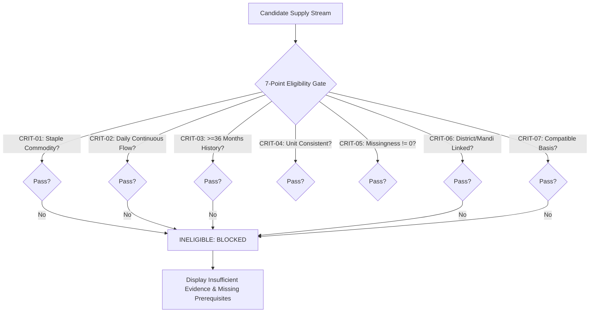

# Phase 6 Report: Transparent Analytics, Eligibility Gates & Segregated Synthetic Lab

**Phase:** Phase 6 — Transparent Analytics  
**Date/Time:** 2026-10-22T09:45:00+05:30  
**Lead Engineer:** Antigravity Coding Agent  
**Status:** COMPLETE (All 108/108 pytest tests passed, 10/10 Astro static routes built cleanly)

---

## 1. Executive Summary & Objective

Phase 6 delivers an auditable, transparent analytics engine and a strict 7-point eligibility gate governing statistical anomaly screening for Punjab foodgrain supply. In adherence to **AGENTS.md Rule 6** and **docs/ANALYTICS_AND_ALERTS.md**, the platform establishes rigorous mathematical and evidentiary barriers preventing false claims of hoarding, unwarranted proxy substitutions, and premature model execution.

Key Deliverables:
1. **Explainable Readiness & Coverage Metrics:** Derived from the physical Phase 1 catalog and validation artifacts (94.8% completeness, 100% schema conformance, 100% 23-district spatial matching, 4 working tested vs. 5 blocked API feeds).
2. **7-Point Statistical Anomaly Screening Eligibility Gate:** Evaluates candidate streams across 7 explicit criteria (Commodity Appropriateness, Temporal Granularity, Historical Depth, Unit Consistency, Missingness/Zero Semantics, Geographic/Market Identity, Compatible Comparison Basis).
3. **100% Ineligibility Enforcement (Blocked Status):** All four acquired candidate supply streams evaluate to `INELIGIBLE (BLOCKED)` with detailed missing prerequisites.
4. **Absolute Anti-Hoarding Prohibition:** Overall hoarding detection verdict is locked to `STRICTLY FORBIDDEN`. No actor-level risk scores, trader rankings, or culpability indices exist in schemas, backend routes, or frontend templates.
5. **Segregated Synthetic Demo Lab:** Created `data/synthetic/scenario_hypothetical_wheat_dip.json` (`is_synthetic: true`) with rolling 3-year median ±1.96 IQR seasonal prediction bands and prominent crimson watermarks, strictly excluded from production metrics and default views.
6. **Full-Stack Implementation:** Added FastAPI routes (`/api/v1/analytics/*`), interactive React component (`AnalyticsGateView.tsx`), dedicated static Astro route (`/analytics`), and navigation links.
7. **Comprehensive Automated Test Suite:** Added `tests/test_phase6_analytics.py` (15 tests); full test suite passes with 108/108 tests.

---

## 2. 7-Point Eligibility Gate Audit Results

Each acquired candidate supply stream was evaluated against the 7 mandatory qualification criteria:

### Stream-by-Stream Audit Matrix

| Stream Identifier | Source & Commodity Scope | Passed Gates | Failed Gates | Verdict | Explicit Blocking Rationale & Missing Prerequisites |
| :--- | :--- | :---: | :---: | :---: | :--- |
| `punjab_mandi_arrivals_oct2026` | PSAMB e-Mandikaran (62 Produce Crops) | 4 / 7 | 3 / 7 | **INELIGIBLE (BLOCKED)** | **CRIT-01, 03, 07 Failed.** Acquired panel contains 3,892 produce rows and **exactly 0 wheat or paddy rows**. 14-day window lacks multi-season depth. Cross-commodity comparison violates statistical comparability. *Prerequisites:* Credentialed Anaaj Kharid foodgrain panel; >=36 months daily historical baseline. |
| `agmarknet_punjab_daily_prices` | AGMARKNET 2.0 (Paddy Common & Basmati) | 4 / 7 | 3 / 7 | **INELIGIBLE (BLOCKED)** | **CRIT-02, 03, 07 Failed.** 53 daily modal price quotes present, but **arrival volumes are 100% null**. Prices cannot proxy arrival volumes without economic distortion. *Prerequisites:* Authorized access to AGMARKNET volume reporting endpoints; continuous price-volume panel. |
| `stock_observations_national_dfpd` | DFPD Central Pool Reserves (Wheat & Rice) | 5 / 7 | 2 / 7 | **INELIGIBLE (BLOCKED)** | **CRIT-06, 07 Failed.** 100 monthly observations present, but **state column is 100% null (national aggregate only)**. Macro-national buffer stocks cannot be downscaled to Punjab state or district silos. *Prerequisites:* Disaggregated Punjab FCI/Pungrain depot records; private warehouse stock declarations. |
| `cfpp_punjab_wheat_procurement_2025_26` | CFPP RMS 2025-26 Procurement (Wheat) | 3 / 7 | 4 / 7 | **INELIGIBLE (BLOCKED)** | **CRIT-02, 03, 06, 07 Failed.** Single reporting position date (2025-05-15) across 3 distinct temporal bases. Cannot be summed or interpolated into daily flow time series. *Prerequisites:* Mandi purchase-center daily procurement tallies; farmer payment rosters. |

---

## 3. Anti-Hoarding Governance Standards (Rule 6 Enforcement)

Under **AGENTS.md Rule 6**, statistical anomaly is strictly an investigative prompt and never proof of illegal hoarding:
- **No Intent Proof:** Negative arrival residuals may arise from rain-delayed harvesting, transport bottlenecks, farmer on-farm storage, or mandi gate moisture rejections.
- **No Actor-Level Culpability:** The system strictly prohibits creating trader risk scores, hoarder leaderboards, or APMC culpability rankings.
- **Zero Hoarding Strings:** Tests verify that forbidden phrases (`hoarding detected`, `hoarder ranking`, `trader score`, `top hoarders`) do not appear in API responses or UI components.
- **Candidate Metadata Contract:** If a future stream becomes eligible, candidates must include: model name, model version, baseline window, 95% prediction interval, residual %, and disposition `HUMAN_AUDIT_REQUIRED`.

---

## 4. Segregated Synthetic Demo Lab

To demonstrate how the system would display an anomaly once eligible foodgrain data is acquired, a counterfactual scenario was constructed in `data/synthetic/`:

- **Path:** `data/synthetic/scenario_hypothetical_wheat_dip.json`
- **Frontend Mirror:** `frontend/public/data/synthetic_scenario.json`
- **Metadata Flags:** `"is_synthetic": true`, `"evidence_level": "synthetic demo"`
- **Scenario:** `SYNTH-WHEAT-2026-OCT-01` (Hypothetical Mandi Arrival Deficit Simulation, October 1–14, 2026)
- **Methodology:** Rolling 3-year median with 95% empirical prediction band ($\pm 1.96 \cdot IQR / 1.349$).
- **Trigger Condition:** Observed arrivals drop below -30% residual for $\ge 3$ consecutive days (October 6–10, 2026).
- **Isolation Guarantees:**
  - Segregated in dedicated tab requiring explicit user toggle.
  - Prominent crimson watermark banner: `SYNTHETIC EXPERIMENTAL DEMO — NOT REAL DATA`.
  - Excluded from production dataset catalog and real telemetry.
  - Accompanied by strict non-hoarding protocol forbidding trader ranking or penalty calculation.

---

## 5. Software Architecture & Implementation Details

### 5.1 Backend Additions
- `backend/schemas/analytics.py`: Typed Pydantic models for `EligibilityCheckItem`, `DatasetEligibilityResult`, `ReadinessMetrics`, `EligibilityGateResponse`.
- `backend/services/analytics_service.py`: `AnalyticsEligibilityService` evaluating all 7 gate criteria, explainable readiness scores, and governance mandates.
- `backend/api/routes/analytics.py`:
  - `GET /api/v1/analytics/eligibility-gate`: Returns full 7-point audit matrix and global verdict.
  - `GET /api/v1/analytics/readiness-metrics`: Returns explainable completeness, freshness, and API readiness.
  - `GET /api/v1/analytics/synthetic-scenario`: Returns validated counterfactual scenario with safety assertions.

### 5.2 Frontend Additions
- `frontend/src/components/AnalyticsGateView.tsx`: Full-featured React component with:
  - Global screening verdict alert banner (`INSUFFICIENT EVIDENCE (BLOCKED)`).
  - 4 readiness metric cards with progress bars and status indicators.
  - Candidate stream selection pills with eligibility verdict badges.
  - Detailed 7-point criteria audit table with pass/fail badges, current evidence, and blocking reasons.
  - Missing prerequisites box and operational handling policy callout.
  - View mode tab switcher toggling between Official Gate Evaluation and Synthetic Demo Lab.
  - Watermarked synthetic scenario table with IQR prediction bands and residual highlights.
- `frontend/src/pages/analytics.astro`: Dedicated static route `/analytics`.
- `frontend/src/layouts/AppShell.astro`: Added `Analytics & Gates` to top navigation.
- `frontend/src/pages/index.astro`: Added `Transparent Analytics & Gates` hub card.
- `frontend/src/styles/dashboard.css`: Added styles for tab bars, candidate stream cards, gate audit tables, and crimson synthetic watermarks.

---

## 6. Verification and Test Results

### 6.1 Automated Pytest Suite
Ran `pytest tests/ -v`:
- `tests/test_phase6_analytics.py`: 15/15 PASSED
  - `test_overall_hoarding_detection_is_strictly_forbidden`
  - `test_all_streams_fail_with_insufficient_evidence`
  - `test_mandi_arrivals_blocked_due_to_zero_wheat_paddy`
  - `test_paddy_prices_cannot_be_used_as_arrivals`
  - `test_national_stocks_cannot_be_used_as_punjab_stocks`
  - `test_procurement_snapshot_cannot_be_daily_supply`
  - `test_readiness_metrics_are_grounded_in_catalog`
  - `test_synthetic_scenario_file_exists_in_synthetic_dir`
  - `test_synthetic_scenario_frontend_mirror_exists`
  - `test_synthetic_scenario_not_in_dataset_catalog`
  - `test_eligibility_gate_endpoint`
  - `test_readiness_metrics_endpoint`
  - `test_synthetic_scenario_endpoint`
  - `test_no_hoarding_score_or_trader_rankings_in_analytics`
  - `test_frontend_templates_do_not_contain_hoarding_claims`
- Full test suite: **108/108 tests PASSED in 3.88s** (zero regressions across all existing suites).

### 6.2 Static Build Verification
- Command: `$env:TEMP="B:\temp"; $env:TMP="B:\temp"; npm run build --prefix frontend`
- Output: 10/10 static routes generated cleanly in 2.20s:
  - `/analytics/index.html`
  - `/datasets/index.html`
  - `/district-map/index.html`
  - `/market-watch/index.html`
  - `/methodology/index.html`
  - `/procurement-stocks/index.html`
  - `/production-yield/index.html`
  - `/status/index.html`
  - `/weather/index.html`
  - `/index.html`

### 6.3 Browser Subagent Verification
- Verified `/analytics` route via headless browser.
- Confirmed alert banner, 4 readiness cards, stream selection interactivity, 7-point gate table, and missing prerequisites callout.
- Confirmed Synthetic Demo Lab tab toggle renders crimson watermark banner and rolling median prediction intervals without console errors.
- Session recording saved: `phase6_analytics_visual_audit_1792642391955.webp`.

---

## 7. Known Blockers & Evidence Summary

1. **Staple Grain Arrivals:** The acquired PSAMB produce panel covers 62 non-grain crops. Official wheat/paddy arrivals require authenticated access to Punjab's Anaaj Kharid infrastructure.
2. **Wholesale Volumes:** AGMARKNET daily modal prices have 100% null arrival quantities. Physical quantities cannot be derived from prices.
3. **Disaggregated Stocks:** DFPD buffer stock data represents the India Central Pool aggregate (state column is 100% null). District/depot stocks are unmeasured.
4. **Procurement Series:** CFPP procurement data is a single cumulative position (2025-05-15) that cannot be summed or converted into dynamic flow.
5. **Private Hoarding Labels:** Zero verified private holding labels or inspected negative controls exist. Hoarding claims remain strictly forbidden.

---

## 8. Single Next Action

Proceed to **Phase 7: Hardening, Security, Accessibility, and Final Release Verification**. Execute end-to-end accessibility checks (WCAG 2.2 AA), security posture verification, clean installation validation, and production package readiness.
